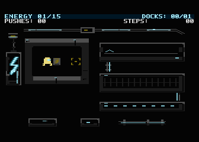
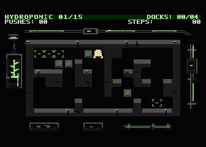
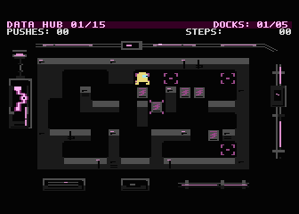
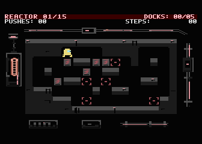

**English** · [Polski](README.pl.md)

# NEON SHIFT 65

Industrial Sokoban for Atari XL/XE PAL, 64 KB. 60 levels in four areas: Energy (01–15), Hydroponic (16–30), Data Hub (31–45), Reactor (46–60).

**Development is suspended.** The owner currently plans no further development. This archival candidate preserves the current local MENUFIX1 + SELECTART1 R6 version, including its graphics, four area scores, level selector, options, up to 256 undo steps, restart, save and Continue.

[Archival prerelease](https://github.com/Setech-pl/neon-shift-65/releases/tag/v1.0.2-archive-r6) · [Normal ATR](https://github.com/Setech-pl/neon-shift-65/releases/download/v1.0.2-archive-r6/neon-shift65-r6.atr) · [Player ZIP](https://github.com/Setech-pl/neon-shift-65/releases/download/v1.0.2-archive-r6/neon-shift65-r6-player.zip) · [Source ZIP](https://github.com/Setech-pl/neon-shift-65/releases/download/v1.0.2-archive-r6/neon-shift65-r6-source.zip) · [SHA256SUMS](https://github.com/Setech-pl/neon-shift-65/releases/download/v1.0.2-archive-r6/SHA256SUMS)

Existing stable [v1.0.1](https://github.com/Setech-pl/neon-shift-65/releases/tag/v1.0.1) remains available separately. The repository remains open, without GitHub Archived mode.

| Energy | Hydroponic |
| --- | --- |
|  |  |
| Data Hub | Reactor |
|  |  |

Actual R6 emulator captures; area starts use isolated test save fixtures. [Media provenance](docs/media/README.md).

Copy the ATR before playing. Mount the writable copy as D1:, select PAL XL/XE 64 KB, BASIC off, MAPRAM off and standard OS SIO. On Atari hold OPTION at power-on to disable BASIC. This is an 8192 × 128-byte sector ATR, not a standard floppy image. A joystick in port 1 is required. NTSC and other storage configurations are unqualified.

[Controls and saving](docs/how-to-play.md) · [Build from source](docs/building.md) · [Release notes](docs/release-notes.md)

Loading/menu delays remain open: **LOAD-FIX1 NOT DONE**. Final graphics acceptance, including Hydroponic, physical Atari PAL/SIO2SD tests and live host F2 handling remain unconfirmed. Emulator checks do not establish hardware acceptance. No new functions or loading fixes were implemented for this publication.

Normal ATR SHA-256: `72f1d0643c562937312d71beeaa7965cda5fd5213b9e3891f292bf55f12dc477`.

Code and technical documentation: [MIT](LICENSE). Project-owned creative content: [CC BY-NC-SA 4.0](LICENSE-ASSETS), with existing exceptions. [Third-party notices](THIRD_PARTY_NOTICES.md) preserve cc65, Void Strike, historical Service Current music and First Dock provenance limitations. Publication does not resolve these open rights questions. Marcin Krzetowski / Setech Game Studio; implementation/tooling assistance by Codex, historical independent audit by Claude. Names and marks remain reserved.
