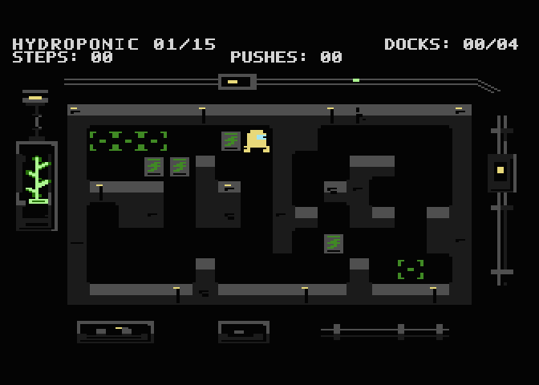
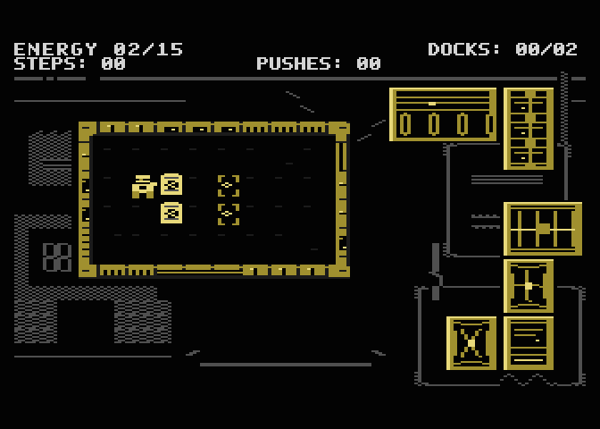
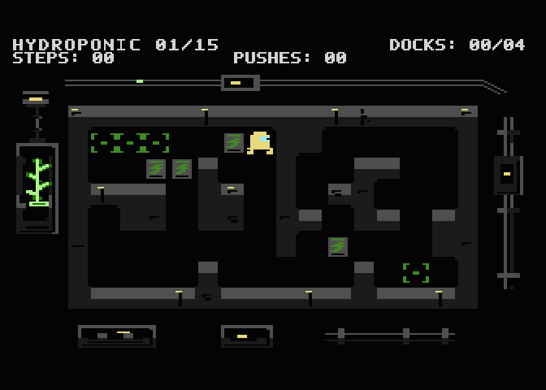
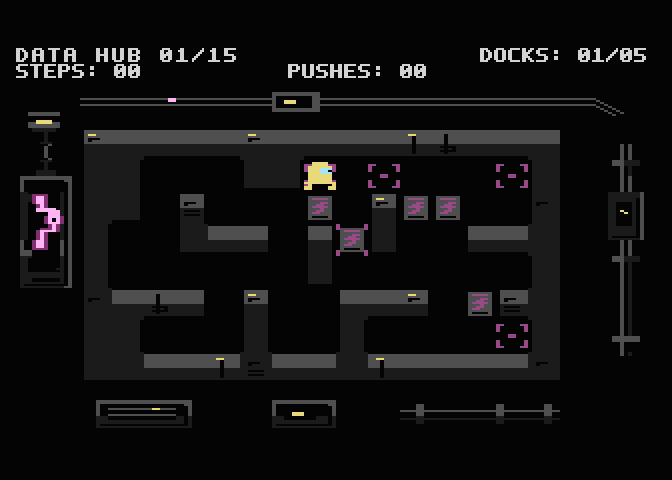
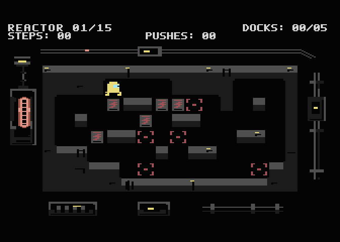

[English](README.md) · **Polski**

# NEON SHIFT 65

**Industrialny Sokoban dla Atari XL/XE PAL, 64 KB.** Poprowadź robota serwisowego przez 60 poziomów. Umieść każdą skrzynię na doku. Skrzyń nie można ciągnąć ani pchać dwóch naraz.

[Zagraj w Setech Arcade](https://setech-pl.github.io/setech-arcade/play/neon-shift-65/) · [Pobierz ATR](https://github.com/Setech-pl/neon-shift-65/releases/download/v1.0.1/neon-shift65.atr) · [Instrukcja](docs/how-to-play.pl.md) · [Emulator Windows / macOS](docs/quick-start.pl.md) · [Budowanie](docs/building.pl.md)



Cztery animowane obszary: Energy (01–15), Hydroponic H2 (16–30), Data Hub (31–45) i Reactor R1 (46–60). Do 256 kroków undo, restart poziomu, zapis postępu i Continue. Wszystkie 60 map początkowych ma niezależnie zweryfikowane rozwiązania. Błędny ruch może zablokować skrzynię — użyj undo lub restartu.

| Energy | Hydroponic H2 |
| --- | --- |
|  |  |
| Data Hub | Reactor R1 |
|  |  |

Rzeczywiste obrazy publikowanego ATR; powiększenie 2× bez wygładzania. [Media](docs/media/README.md)

## Uruchomienie

Zamontuj **zapisywalną kopię** normalnego ATR jako **D1:**. Wybierz PAL, XL/XE 64 KB i **BASIC OFF** (na Atari przytrzymaj OPTION podczas zimnego startu). W menu wybierz BEGIN SHIFT albo CONTINUE joystickiem i FIRE. Obraz ma 8192 sektory po 128 B; SIO2SD musi obsługiwać ten format i zapis.

**Windows:** skorzystaj z [instrukcji Altirra](docs/quick-start.pl.md#windows--altirra). **macOS:** skorzystaj z [instrukcji Atari800](docs/quick-start.pl.md#macos--atari800). Obie opisują pobranie gry, ustawienie joysticka w porcie 1, klawisze konsoli i zapis postępu. Do grania nie potrzebujesz narzędzi programistycznych.

Sterowanie: joystick — ruch/pchanie; FIRE lub SELECT — undo; OPTION — restart; START — pauza. SELECT podczas pauzy zapisuje i wraca do menu. Pełny opis zapisu i konfiguracji w instrukcji.

## Źródła

```sh
python3 tools/build.py --out build/release
```

Python 3, Node.js, cc65 i clang. Build nie wymaga ROM-u ani emulatora. [Build](docs/building.pl.md)

Normalny ATR odtworzono ze źródeł; odpowiada wersji sprawdzonej w emulatorze, obejmującej przejście 60/60 poziomów. Test fizycznego Atari/SIO2SD i odsłuch właściciela pozostają niepotwierdzone. Nie deklarujemy zgodności NTSC.

## Twórcy i licencje

© 2026 Marcin Krzetowski / **Setech Game Studio**. Gra rozwijana z pomocą Claude Code i Codex. [Credits](docs/credits.pl.md)

Kod, narzędzia i dokumentacja techniczna: [MIT License](LICENSE). Grafika, fonty, mapy, twórcze teksty i obrazy z gry: [Creative Commons Attribution-NonCommercial-ShareAlike 4.0 International](LICENSE-ASSETS). Pełny tekst CC znajduje się [tutaj](docs/licenses/CC-BY-NC-SA-4.0.txt). Licencja podąża za treścią także w plikach mieszanych. Cały ATR jest udostępniany na CC BY-NC-SA 4.0 z zachowaniem notices kodu MIT i cc65. Wcześniejsza deklaracja CC0 dla „Service Current” pozostaje ważna; cc65 oraz adaptacje Void Strike zachowują własne warunki i autorstwo. Nazwy i znaki studia są zastrzeżone. [Komponenty i wyjątki](THIRD_PARTY_NOTICES.md).
