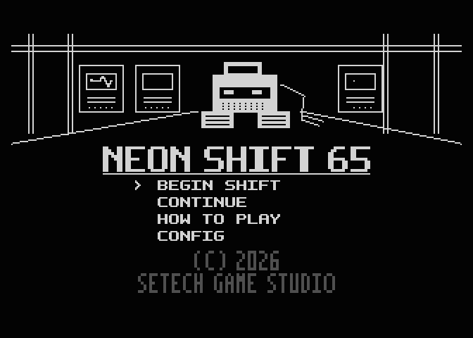
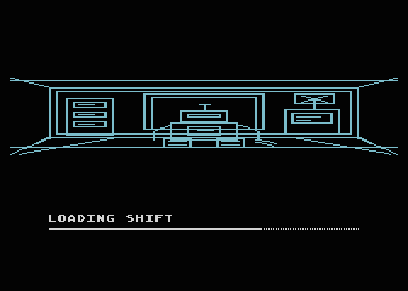

[English](README.md) · **Polski**

**HWVIS1 — OWNER_PENDING. Atari XL/XE PAL 64 KB + SIO2SD:** przy włączaniu trzymaj **OPTION**, aby wyłączyć BASIC. Nowy obraz czeka na odbiór wyglądu, przejść, zapisów i dźwięku na Atari; prawa pozostają otwarte. Raport: [HWVIS1](docs/hwvis1/REPORT.md).

# NEON SHIFT 65

**Gra logiczna Sokoban na Atari 65XE PAL: 60 poziomów w czterech przemysłowych obszarach.**

Steruj robotem serwisowym, przepychaj ładunki na doki i przywracaj stację do działania, pokój po pokoju. Energy, Hydroponic, Data Hub i Reactor mają po 15 poziomów. Cały pokój pozostaje widoczny; planowanie i cofanie pomyłek są częścią zmiany.

**[Pobierz normalny ATR](dist/neon-shift65-v1.0.0.atr)** · [ZIP gracza](dist/neon-shift65-v1.0.0.zip) · [Wydania GitHub](https://github.com/Setech-pl/neon-shift-65/releases)

**Przygotowanie 1.0.0: DRAFT.** Wydanie stabilne nie jest jeszcze opublikowane. Odbiór sprzętu/wyglądu i konkretne decyzje prawne pozostają otwarte.

*Cztery zmontowane fragmenty gry; nagranie z zamrożonych ATR-ów w Atari800, czas PAL, całkowitoliczbowe 2× nearest-neighbour. Hydro/Data/Reactor nagrano ze startów testowych. To nośniki testowe, a nie wybór obszaru w normalnej grze. [Pochodzenie nagrania i GIF-y obszarów](docs/media/README.pl.md).*

## Cztery obszary

| Energy · poziomy 01–15 | Hydroponic · poziomy 16–30 |
| --- | --- |
|  |  |
| **Data Hub · poziomy 31–45** | **Reactor · poziomy 46–60** |
|  |  |

| Menu | Loader |
| --- | --- |
|  |  |
## Rozpocznij zmianę

1. Przed grą skopiuj `neon-shift65-v1.0.0.atr`; zapis postępu modyfikuje obraz dysku.
2. Zamontuj zapisywalną kopię jako **D1:**. Ustaw **PAL**, **64 KB XL/XE**, **BASIC wyłączony**. Na prawdziwym 65XE trzymaj **OPTION** przy włączaniu, aby wyłączyć BASIC.
3. Poczekaj na loader i menu; wybierz **BEGIN SHIFT** joystickiem w porcie 1 i FIRE. **CONTINUE** odtwarza zapisany postęp.

| Wejście | Podczas gry |
| --- | --- |
| Kierunki joysticka | Chodzenie; pchanie jednej skrzyni, bez ciągnięcia |
| FIRE lub SELECT | Cofnięcie udanego kroku, do 256 kroków |
| OPTION | Restart bieżącego poziomu; zerowanie liczników i undo |
| START | Pauza; ponowny START wznawia |
| SELECT w pauzie | Zapis i powrót do menu tytułowego |
| FIRE w pauzie | Konfiguracja: lewo/prawo muzyka, FIRE efekty, START powrót |

Po rozwiązaniu poziomu zwolnij sterowanie i naciśnij **świeży FIRE**, aby przejść dalej; **SELECT** nadal cofa ostatnie pchnięcie. FIRE odebrany podczas ruchu zachowuje intencję undo. Przejście dalej automatycznie zapisuje następny poziom, a finał zapisuje ukończenie. Zimne CONTINUE odtwarza planszę i liczniki z **pustym undo**. Błąd zapisu pozwala ponowić próbę; nie wyjmuj dysku podczas I/O.

Undo wykonuje jedną akcję na naciśnięcie; przed następną zwolnij przycisk. Pauza zachowuje undo w tej samej sesji; nowy poziom i restart je zerują. Bardzo krótki impuls kierunku podczas kończenia kroku może zostać pominięty; używaj świadomego przytrzymania/zwolnienia. Ustawienia muzyki/efektów utrwalają się z udanym zapisem gry.

Launcher właściciela mapuje WASD/M i F2/F3/F4 na joystick/FIRE i OPTION/SELECT/START. Inne emulatory mają własne mapowanie.

## Wymagania i ograniczenia

Cel: Atari 65XE PAL, standardowe 64 KB, joystick w porcie 1, zapisywalne D1: SIO2SD obsługujące obraz **8192 × 128 B** (1 048 592 B z nagłówkiem). BASIC musi być wyłączony; gra używa pamięci pod BASIC. ATR nie jest obrazem fizycznej dyskietki 720 × 256 B. NTSC, CA-2001, inne maszyny i firmware nie są zakwalifikowane.

Dowody emulatorowe RELEASE1 obejmują 60/60 poziomów, przejścia i finał, undo256, zapisy, zimne Continue i standardowe OS SIO. Niezależny re-review zamyka A-01–A-03 dla dokładnych bajtów dystrybucji. **Sprzęt fizyczny i ostateczny wygląd: OWNER_PENDING.** To osobne wyniki względem emulacji. Nie deklarujemy badań graczy ani udowodnionej liniowej trudności.

## Instrukcje i rozwój

[Jak grać](docs/how-to-play.pl.md) · [Szybki start](docs/quick-start.pl.md) · [Dokumentacja](docs/README.md) · [Bieżący build](docs/building.md) · [Informacje o wydaniu](docs/release-notes.pl.md) · [Odbiór właściciela](docs/owner-smoke.pl.md)

Produkcyjny builder: `python3 tools/v1_build.py --out build/my-release` (nowy katalog wyjściowy). Główny Makefile dotyczy archiwalnego prototypu. Pakowanie nie przebudowuje ani nie zmienia zaakceptowanego ATR. Rozwój funkcjonalny zamrożony; utrzymanie obejmuje wyłącznie potwierdzone błędy.

## Autorzy i licencje

Marcin Krzetowski / **Setech Game Studio**, z udokumentowaną pomocą Codex przy implementacji i narzędziach oraz niezależnym audytem Claude. [Autorzy i pochodzenie](docs/credits.pl.md).

Własny kod, narzędzia i dokumentacja techniczna: [MIT](LICENSE). Własna grafika, fonty, mapy, kreatywne teksty i materiały wizualne: [CC BY-NC-SA 4.0](LICENSE-ASSETS), z jawnymi wyjątkami. Linkowany runtime cc65 i adaptacje Void Strike zachowują swoje notices. **Prawa muzyki i pochodzenie historycznego First Dock nadal otwarte**; zobacz [notices](THIRD_PARTY_NOTICES.md). Nazwy i logo studia są zastrzeżonymi oznaczeniami; licencje nie przyznają praw do marki.
