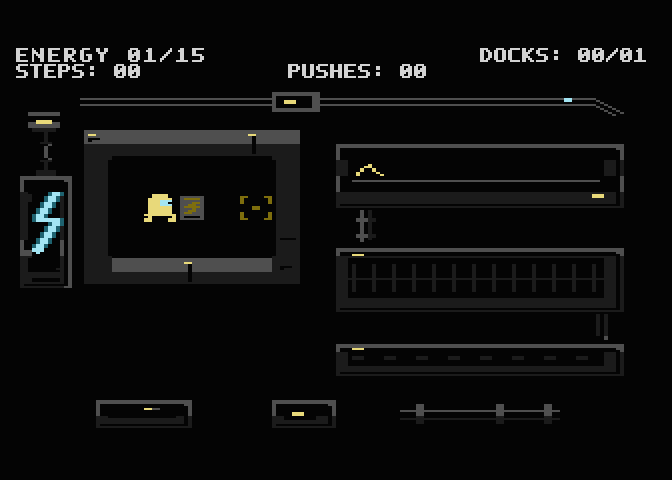
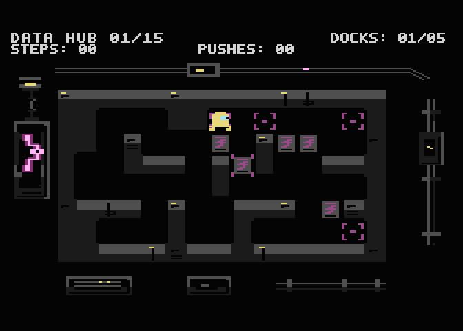
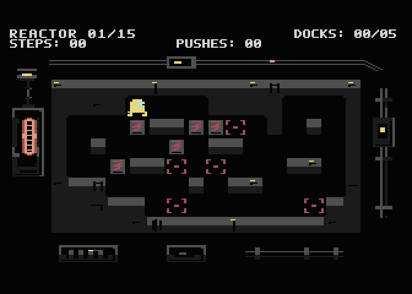
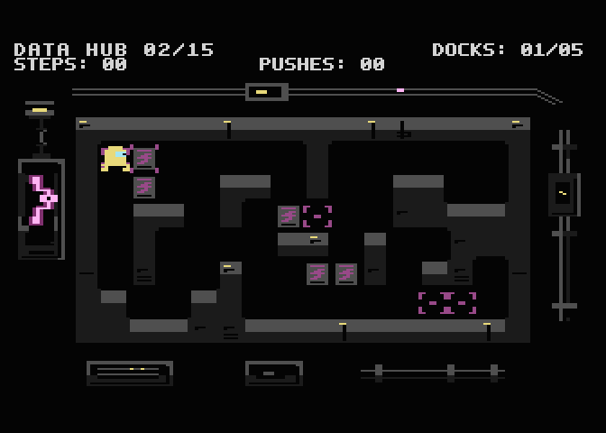

# Gameplay captures

These images and GIFs show the exact normal disk released as v1.0.1, SHA-256
`a22992f1c4350d0e5c72150c6902aefdd2f485c3be5979f9da2a7bc2d32f3407`.
Captured in Atari800 PAL, 336×240, displayed at 2× nearest-neighbour scaling.
No retouch, mockups or changed game colours. Energy starts at BEGIN SHIFT;
later areas use Continue on isolated copies with area-start save records.
The release disk itself contains no test saves. Each area GIF lasts 6.4 s.

| Energy | Hydroponic | Data Hub | Reactor |
| --- | --- | --- | --- |
|  |  |  |  |

Images: [CC BY-NC-SA 4.0](../../LICENSE-ASSETS), © 2026 Marcin Krzetowski /
Setech Game Studio. These are emulator captures, not photographs of an Atari.
