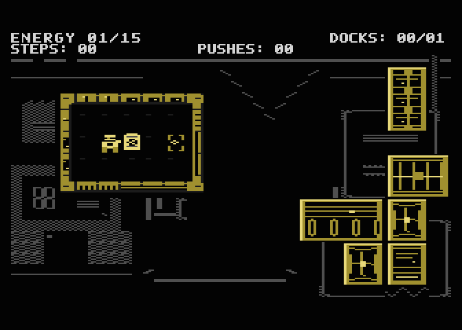
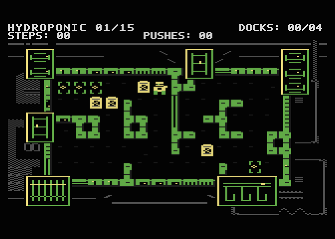
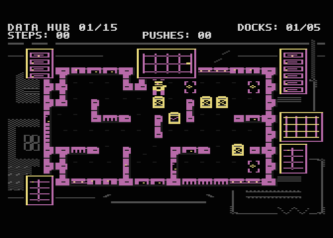
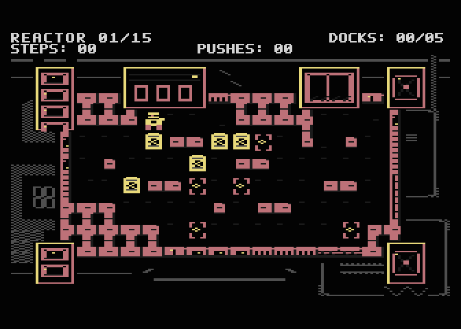

**English** · [Polski](README.pl.md)

# Gameplay gallery

[Main montage](neon-shift65.gif): four 200-PAL-frame excerpts, about 16 seconds in total, with hard cuts between areas. The Energy excerpt shows pushing onto a dock, SELECT undo and redocking. Other excerpts show only short opening prefixes, never complete late-map solutions.

Menu, loader and all four rooms are also visible in the [main README](../../README.md). Energy screenshot is level 2; the Energy GIF is level 1. Hydro/Data/Reactor are levels 16/31/46 from dedicated test-start images. Their campaign/graphics sectors match the normal release. Startup and save identities differ; the normal game does not offer area-select.

Actual Atari800 7.1.2 cold-boot frames from copies of the identified ATRs, no generated gameplay, object editing, palette changes or smoothing. 336×240 captured pixels are enlarged exactly 2× to 672×480. Every fifth PAL frame is sampled; GIF duration retains game time (centisecond rounding). Host turbo only removes waiting on the host.

Regenerate: `python3 tools/hwvis1_prepare.py`, then set NEON_ATARI800 to an Atari800 7.1.2 NS65 observer binary and NEON_ATARI_CONFIG to your private legal ROM config; run `python3 tools/hwvis1_media.py`. Requires ffmpeg. [Manifest](manifest.json) records hashes, settings, frame ranges, inputs, timing and montage; [equivalence](product-equivalence.json) records source differences and media identity. Raw frames/RAM/configs stay ignored under build/owner-smoke/hwvis1/media. No emulator or ROM is distributed.

HWVIS1: standard OS SIO (`-nopatch`), BASIC OFF, XL/XE 64 KB PAL. All current GIFs and screenshots were refreshed from the new ATRs. Hardware/appearance: OWNER_PENDING.
